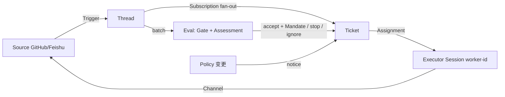

# 00 总览：Super-agent 是什么，以及在本机怎么落地

> 本文是整套研究的总纲与判断，不重复细节。机制细节见 [01 架构深读](01-architecture-deep-dive.md)，上游原型逐文件说明见 [02 原型档案](02-official-prototype-digest.md)，Windows 实操见 [03 部署手册](03-local-deployment-runbook.md)，自建实现见 [04 本地实现](04-local-implementation.md)，验收记录见 [05 验收报告](05-validation-report.md)，事实核查（含对本系列文档的纠错）见 [06 事实核查](06-fact-check.md)。

---

## 1. 一句话结论

DeepSeek Harness 团队 2026-10-31 公开的 Super-agent，不是一个模型，也不是一个能直接装的产品，而是一套"常驻在线、以事件为输入、把会话管理上移到系统层"的 Agent 运行时设计；配套开源的是 dsh-superagent 研究原型（MIT，单仓库 GitHub + 可选飞书，作为 DSH 插件包运行）。

它真正的新东西只有一句话：把"人手动切会话"换成"系统自动分诊 + 并行执行 + 结果回到原对话"。其余组件（调度、缓存、存算分离、看门狗）都是把计算机系统的经典思路搬进 Agent。

三个必须先接受的判断：

1. 它是研究原型，不是产品。上游 README 第一段自述 "Research prototype for reference only, not an official DeepSeek product"，并明确说"文章里讨论的部分设计是未来方向，原型未实现"。任何"生产可用"的表述都不成立。
2. 它的收益是注意力和时延，不是编码能力。官方实验用的是合成消息流、编码工作由"只耗时的工具"模拟，原文自述结果 "indicative only"。把它换算成"编码效率提升 X 倍"是越界推断。
3. 它的成本是权限。Router 与 Worker 都以 operator 的 OS 用户、近乎无审批地跑；上游建议用只放 Agent 凭据的独立系统账号。这条比任何架构细节都重要。

---

## 2. 材料边界：哪些是硬事实，哪些是转述

| 层级 | 材料 | 可信度 | 用法 |
| --- | --- | --- | --- |
| 一手代码 | deploy/upstream/dsh-superagent-prototype（git clone，MIT） | 最高 | 一切"原型是否有 X"的判断以此为准 |
| 一手文档 | 仓库内 docs/000–008、README.md、SETUP.md、prompts/、cordis.patch.yml | 高（文档与代码冲突时以代码为准） | 概念、规则、部署步骤 |
| 二手报道 | IT之家 2026-10-31、新浪/环球网 2026-11-01、qiniu 2026-11-01、technode 2026-11-02 等 | 中 | 只用于补"设计意图"和背景，数字一律回查 |
| 未证实 | 官方技术文章《Super-agent 设计探索：迈向更自主的 Agent 系统》的一手 URL | 未定位 | 引用时写"据 XX 报道转述"，不编造 deepseek.com 链接 |

由此产生的第一个纪律：本系列文档里每一条"原型实现了 X"，都必须能指到文件或行；指不到的，写成"文章设计"。详见 [06 事实核查](06-fact-check.md)，那里推翻了本系列早期版本的一批说法（包括"五模块"的分组方式、"官方第 4 条命令可原样执行"、"setup 一条龙脚本在 Windows 可用"、"stateDir 可填盘符路径"）。

---

## 3. 它要解决的真问题：人的注意力成了并发上限

前提是个反直觉的观察：单任务已经不需要人，限制产出的是人同时能盯住几个会话。

- 主流 Coding Agent 以"单个 Session"为调度单位，Session 之间互相独立。
- 一个人通常只能同时跟进 3–5 个活跃 Session（官方观察值）。
- 于是真实工作流变成：群里定了方案 A → 到 PR 评论里改成方案 B → 两条信息落在两个会话 → 用户自己搬上下文。
- 用 CLI / MCP / 连接器扩展本地 Agent，也只是把"会话"变多，没解决"上下文在会话之间断裂"和"本地设备离线任务就停"。

Super-agent 的四特征（连续、高效、主动、持久）本质上是对这四个断点的回答：跨渠道同一件事、多任务并行不阻塞、环境事件自己推进、进程/设备故障可恢复。

> 注意：四特征是目标，不是已实现清单。原型实现了"连续"（GitHub/飞书两个 Source + 订阅直通）和"高效"（多 Ticket 并行 + worker slot）；"主动"只到"按规则评估后接单、默认 observe 只记录"；"持久"只到"进程内重启恢复 + 外部定时巡检"，存算分离并未实现。

---

## 4. 真正的架构：不是"两个进程"，是一套领域模型

媒体把它讲成"Router + Worker 双层"，容易误解成两个服务。看代码和 docs/001-domain.md，它其实是一套以事件和授权为中心的领域模型——这一点决定了后面所有实现取舍。

| 概念 | 一句话 | 为什么必须有它 |
| --- | --- | --- |
| Source | 事件流的一种实现 + 一份实例配置 | 持有读取位点、自己的 bot 身份、去重规则；重启不重放 |
| Trigger | 一条不可变事件 | 审计与幂等的最小单位（同一 Trigger 接两次只产生一个 Ticket） |
| Thread | 按时间排序的 Trigger 集合 | 同一 Thread 上 Eval 串行，给出"一致视图" |
| Eval | 对一批 Trigger 的判定，两层：Gate（确定性准入）+ Assessment（模型研判） | 媒体说的"两级过滤"就是这一层，不是另一个进程 |
| Decision | accept / stop / ignore / unavailable | 判定产物，可审计 |
| Mandate | accept 授予的授权凭证：Policy 版本 + 范围 + 强度 | 把"凭什么能做这件事、能做多远"变成不可变对象 |
| Ticket | 授权工作单元（工单） | 自己定义状态，不跟随执行器的会话状态 |
| Assignment | Ticket 到一个 Executor 实例的绑定 | 执行器在领域之外，但"谁在跑"必须在领域之内 |
| Subscription | Ticket 与 Thread 多对多 | 后续讨论自动到达执行器，不用再 @ 一次 |
| Channel | Thread 的写入侧 | 回执、回复、PR、review 都是一种写入 |

三个容易搞错、但很关键的约束：

1. 订阅直通绕过 Gate，但不授予任何新权限。原文：*"This delivery bypasses the gate and grants no new authority. Each Ticket remains limited by its Mandate."* 所以"直通 = 提权"是错的；它只是让上下文到达得早、快到不经过 Router。
2. Correlation 只加上下文，绝不路由。路由只由 Subscription 决定。这条把"相关"和"授权"彻底分开，避免"看起来相关就被拉进执行"。
3. Policy 变更不撤销已发出的 Mandate。变更会被记录并投递给 Assignment，Ticket 恢复前才重新校验。这是"不打断半成品工作"的取舍。

---

## 5. 文章的五模块 vs 原型的实际落点

官方文章按 02–06 编号讲了五块；社区转述常把它压成"五个技术点"，导致归属错乱（例如把异步工具算进"持久"）。正确对应关系：

| 文章模块 | 设计意图 | 原型里的落点 | 状态 |
| --- | --- | --- | --- |
| 02 双层架构 | 主会话只分诊、Worker 隔离执行 | Main Session（orchestrator）+ Executor Session（worker-<ticket>），DSH Session 隔离 | 已实现 |
| 03 事件驱动 | 环境事件即输入，两级过滤 | Source→Trigger→Thread→Eval(Gate+Assessment)，Passes 每 2s 合批 | 已实现 |
| 04 全双工多渠道交互 | 多入口同一件事；异步 start/stop 让前台不被长命令堵死 | GitHub + 飞书两 Source；worker preset 5s 后把前台 shell 转后台 job | 部分实现（异步工具由 DSH 提供，原型借用） |
| 05 存算分离 | 计算在云端、状态单独存、仓库留在本地 | 未实现：单机 dsh --profile superagent 进程 + 本地 stateDir | 未实现 |
| 06 Watchdog | 外部巡检，判断有无实质进展 | 外部定时 schedule + 健康项 + 退出码 + 预算重试；无模型级进展判断 | 部分实现 |

另有三条机制（不是模块，但被反复引用）：订阅直通（已实现）、上下文当缓存 / Inline & Spill + 链式召回（原型用分页资源 + 按 id 展开 + 卡片 + compaction 实现，机制同源、命名不同）、异步工具（DSH 提供、原型使用）。

---

## 6. 为什么这些取舍成立（设计者的算盘）

- 为什么要订阅直通：没有它，每条后续评论都要回 Router 重新决定；Router 的每一次决策都要重读整段上下文。官方数据：去掉直通，完成时间几乎不变，但 Router 决策数 +30%、读缓存 Token +37%。直通买的是 Token 和决策数，不是时延。
- 为什么 Router 可以配弱模型：Router 只做分诊和回话，不做代码；Worker 才需要最强模型。这是成本结构，不是能力结构。
- 为什么 Watchdog 必须在 Agent 之外：Agent 卡死时，它自己判断不了自己卡死。所以巡检是"另一个 profile 里的 schedule + 退出码 + 健康项"，而不是 Agent 内部的一个循环。
- 为什么"更堵反而更便宜"：Trigger 从 1/min 涨到 40/min，平均 batch 从 1.0 涨到 2.8，单次请求只从 2.5s 涨到 3.9s，单决策分摊推理从 6.4s 降到 1.6s。合批把并发压力换成了单位成本下降——这是它敢做"主动"的经济前提。
- 为什么"少说话"是硬指标：哲学文档把"消息、通知、提问、面板元素、文档段落"全部按"注意力成本"计价，给不出价值就删。这不是文风，是产品约束。

---

## 7. 本地落地的两条路线（决策矩阵）

| 维度 | A：官方原型（DSH 插件包） | B：自建最小实现（local-superagent/） |
| --- | --- | --- |
| 前置 | DSH 0.2.1 系列 + pnpm + GH 账号 + 单仓库 | 只需 Node 24（内置 sqlite/http/test） |
| Windows 可行性 | **原生跑不通**：两道 POSIX 硬墙——stateDir schema /^\// 拒盘符（可 2 行补丁绕过）；setup 探针一律用 env 包装进程 → spawn env ENOENT（无小补丁可绕，须换运行时） | 原生可跑 |
| 真实模型 | 走 DSH 的模型配置，接任意 OpenAI 兼容网关 | 环境变量直连，无 Key 自动 mock |
| 事件源 | GitHub（+飞书），仅一个仓库，不支持 GHES | 任意 JSON 事件（stdin/HTTP/文件），可接自建 webhook |
| 隔离强度 | 依赖 DSH preset + 执行目录 | 项目内 .work/<taskId>/ + 工具白名单 |
| 复盘/审计 | 面板 + SQLite | SQLite + /api/* |
| 适合 | 想原样体验官方设计、有 Linux/WSL 或愿意绕路 | 想在 Windows 上真跑、想改、想嵌进自己的工作流 |
| 结论 | 学架构、跑 demo | 本机主力落地 |

推荐组合：先用 B 在 Windows 上把"事件→分诊→并行执行→回原对话"跑通（当天可跑），再用 A 在 WSL/Linux 或 POSIX 路径下对照官方实现，验证自己的理解没跑偏。二者共用同一套领域词汇，见 [04](04-local-implementation.md) 的逐条对照表。
**落地结果（2026-11-02 19:12 实测）**：

- **B 路线（自建）**：`scripts/verify.ps1` → `RESULT: PASS`（EXIT=0）。20/20 测试、30/30 demo 断言、159/159 独立探针检查。两次修补后仍 PASS，缺陷台账见 [05](05-validation-report.md) §12。
- **A 路线（官方原型）**：止步于「插件挂载 + 管理面 API 200 + 建库成功」，setup 自检卡在 `spawn env ENOENT`；首个工单与 PR 未验证。详见 [03](03-local-deployment-runbook.md) §1 与 §5。
- **仍存在的残余风险**：非协作型 provider（忽略 AbortSignal）的模型调用不可中断，stall 时会挂一个 Promise 至多一个 LLM 超时周期；订阅无自动关闭（只有显式解绑）；workdir 按 taskId 复用存在极窄 TOCTOU；真实模型/真实渠道/跨机部署全部未测。

---

## 8. 红线（比架构更该先读）

1. 权限：Router/Worker 以 operator 的 OS 用户、近似无审批执行，能读主目录。用独立系统账号，只放 Agent 凭据。
2. 从窄处开始：accept mode 默认 observe——推断类工作只记录不执行。先只看"它本来会做什么"，再放开 auto。
3. 白名单先只放自己：admission table 里"未列名单但 @ 了 Agent"的单元格默认 ignore，别为了"方便"改成 explicit。
4. 不要自动合并：上游 SETUP 的推荐答案是"否"。等 PR 连续一段时间无问题再考虑。
5. 不要制造音量：mass PR、群播、无意义催更，成本由同事承担。这条写在哲学文档里，是运营红线不是技术限制。
6. 别把它当产品：版本会破坏性变更，代码大量由 Coding Agent 写成。升级前备份 stateDir（SQLite + 锁 + worker 配置 + 工作目录都在里面）。

---

## 9. 实验数据怎么读

| 指标 | 数值 | 读法 |
| --- | --- | --- |
| Super-agent 完成时间 | p50 12.4 min / p95 15.7 min | 合成负载（~300 条消息、~20 个工作请求），每方案 5 次 |
| 单 Session + Subagent（中性提示词分支） | p50 20.4 min / p95 29.5 min，5 次里 Subagent 一次都没被调用 | 所以这一支实际是"单会话串行"，不是"多智能体" |
| 单 Session + Subagent（委派优先分支） | p50 13.8 min / p95 29.0 min，5 次里 4 次委派 | 委派率上去了，长尾仍差一倍 |
| 去掉订阅直通 | 12.4/15.7 → 12.6/15.5 min（无显著变化）；Router 决策数 +30%；读缓存 Token 23.2M → 31.8M（+37%） | 直通买的是成本与决策数，不是时延 |
| 负载升高 | Trigger 1→40 /min；平均 batch 1.0→2.8；单请求 2.5 s→3.9 s；单决策分摊推理 6.4 s→1.6 s | 合批把并发压力换成单位成本下降 |

三条边界：合成负载、编码被工具模拟、只跑 5 次。能说的是"在消息密集的多任务场景下，双层 + 直通把从请求到结果的时延压得更短更稳，且单位决策成本更低"；不能说的是"编码更快/更强"。数值口径与逐条出处见 [01](01-architecture-deep-dive.md) 与 [06](06-fact-check.md) 的防篡改区。

---

## 10. 文档地图

| 文件 | 内容 |
| --- | --- |
| [01 架构深读](01-architecture-deep-dive.md) | 领域模型、五模块机制、状态机、上下文管理、实验与局限 |
| [02 原型档案](02-official-prototype-digest.md) | 仓库结构、文件职责、配置字段、授权模型、已知缺陷 |
| [03 部署手册](03-local-deployment-runbook.md) | A 方案实测步骤与排错 + B 方案入口 |
| [04 本地实现](04-local-implementation.md) | local-superagent/ 设计、表结构、与官方逐条对照 |
| [05 验收报告](05-validation-report.md) | 端到端用例、实测输出、失败项 |
| [06 事实核查](06-fact-check.md) | 逐条声明 → 出处 → 判定；本系列的纠错记录 |
| [07 托管可行性](07-loop-hosting-feasibility.md) | 本机能否常驻 loop、小项目托管清单、三档自启、容量实测 |
| [08 自 loop 实跑](08-selfloop.md) | 让 loop 管本项目的真实一轮：4 进 4 出、产物、人在环里的三步 |
