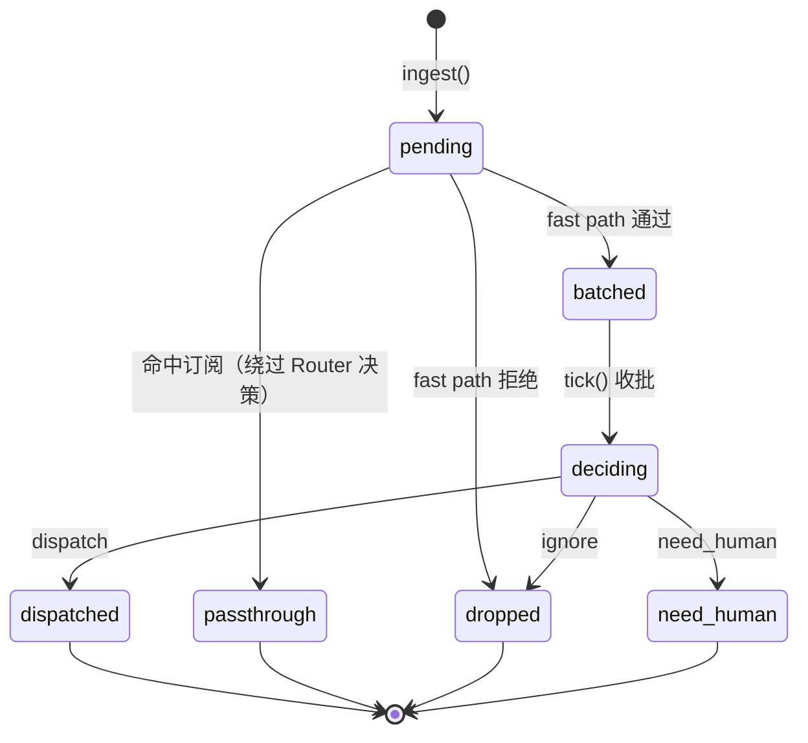
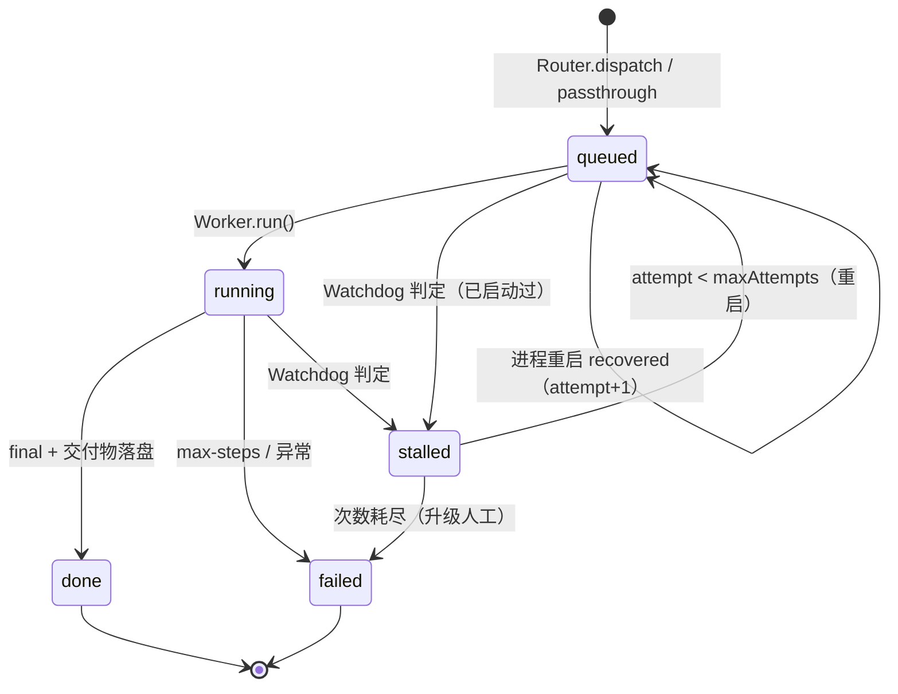

# 04 · 本地自建 Super-agent 最小实现（local-superagent/）

> 本文只描述 `local-superagent/` 这一套**自建**实现：纯 Node 24 内置模块、零重型依赖、不依赖 DeepSeek Harness、不需要 API Key 即可跑完整链路。
> 它不是官方原型的复刻，也不对官方原型的可运行性下任何结论。凡是涉及官方侧的说法，一律按三态标注。

## 0. 标注约定（读之前先看这个）

官方侧三态：

| 标记 | 含义 |
| --- | --- |
| 【文章设计】 | 官方技术文章里写的设计意图 |
| 【原型已实现】 | 官方开源原型里确实有对应代码 |
| 【两者有差距】 | 文章写了、原型没有或只有简化版 |

本实现侧三态（针对本机 Windows 11 + Node 24.19.0 的实测）：

| 标记 | 含义 |
| --- | --- |
| [已实测通过] | 本机实跑通过，命令与输出可在 `local-superagent/evidence/` 查证 |
| [已实测失败+原因] | 本机实跑失败，附失败现象与原因 |
| [未实测] | 只写了代码或只做了静态推演，没有实跑证据 |

**一句必须先说清的话**：本文不写"官方五模块已全部落地"。本实现是**按文章公开的机制自建的最小系统**，它在若干点上做了等价物、在若干点上明确退化（见 §11）。官方原型自身的实现状态以 `docs/02` / `docs/06` 为准。

---

## 1. 目标与边界

### 1.1 目标

1. 把文章里被反复提到的**机制**做一个能跑、能测、能观测的最小版本：双层（Router/Worker）职责分离、事件驱动两级过滤、批量合并、订阅直通、上下文即缓存（Inline & Spill + 链式召回）、持久化与恢复、外部巡检。
2. 全部落在 Node 24 内置能力上：`node:sqlite`（持久化）、`node:http`（面板）、`node:test`（测试）、`node:child_process`（受限 shell）。**零 npm 依赖**，`node_modules` 不存在也能跑。
3. 每一个机制都要有**可观测证据**：计数器、事件表、决策表、落盘证据，能被独立验收（T5）复跑。

### 1.2 明确的边界（不做的事）

- 不做 GitHub / Slack / 邮件的真实对接。渠道只是一个 `source` 字段 + 一个 `outbox` 表；接真实渠道是替换 `Router.say()` 与 `Engine.submit()` 的调用方，见 §8.4。
- 不做多机部署、不做远程状态存储。状态就是本机一个 SQLite 文件。
- 不做 OS 级沙箱。Worker 的隔离是"独立 session + 独立目录 + 工具白名单"，不是容器/虚拟机。
- 不追求决策质量。默认走 mock 大脑；接真实模型后质量取决于模型与 policy 提示词。

---

## 2. 模块图

```mermaid
flowchart TB
  subgraph CH[渠道 / 事件源]
    CLI[CLI submit]
    HTTPIN[外部 webhook 适配器<br/>未实现，占位]
  end

  subgraph RT[Router（常驻，只分派）]
    F1[Fast Path<br/>source/group/allowlist/regex/dedupe/rate]
    PT{订阅直通?}
    BQ[(batch 队列)]
    F2[Slow Path<br/>LLM × 1 per batch]
    DEC[decisions]
    GC[(Router 全局上下文<br/>resident session)]
  end

  subgraph WK[Worker（每工单一份）]
    WS[(worker session<br/>独立上下文)]
    WD[(workdir .work/taskId)]
    TL[工具白名单<br/>fs.* / shell(allowlist) / git(status,diff,log)]
  end

  subgraph ST[状态层]
    DB[(SQLite<br/>triggers/tasks/sessions/<br/>subscriptions/messages/events/hops/decisions)]
    SP[(spill 大对象<br/>state/spill/sess/msg.md)]
  end

  WD2[Watchdog<br/>stall / loop / llm-error]
  PN[HTTP 面板 :3182<br/>待人工决策 / tasks / subs / events]

  CLI --> F1
  HTTPIN --> F1
  F1 -->|drop| DB
  F1 -->|pass| PT
  PT -->|命中| WS
  PT -->|未命中| BQ --> F2 --> DEC
  DEC -->|dispatch| WD
  DEC -->|ignore| DB
  DEC -->|need_human| PN
  GC --- F2
  WD --> WS
  WS --> TL
  WS --> SP
  WS -->|report（不对外说话）| GC
  WD2 --> DB
  WD2 -->|restart| WD
  DB --- PN
```

### 2.1 代码地图

| 文件 | 职责 | 关键导出 |
| --- | --- | --- |
| `src/config.mjs` | 全部可调参数，env → cfg，路径全部约束在包内 | `loadConfig`, `acceptRegex` |
| `src/db.mjs` | schema + 仓储层（SQL 只在这里） | `openDb`, `Repo`, `newId` |
| `src/llm.mjs` | OpenAI 兼容 adapter + 无 Key 自动降级 | `LLMClient`, `parseJsonLoose`, `LLMError` |
| `src/mock.mjs` | 离线确定性大脑（router 判定 + worker 计划） | `mockRouteDecision`, `mockWorkerStep` |
| `src/context.mjs` | Inline & Spill + 链式召回 | `ContextStore` |
| `src/filter.mjs` | 两级过滤（程序层 + 语义层）+ 批量 | `FilterPipeline` |
| `src/tools.mjs` | Worker 工具白名单与目录逃逸防护 | `Toolbox`, `TOOL_SPEC` |
| `src/worker.mjs` | 单工单执行循环、工具调用、交付物、回报 | `Worker` |
| `src/router.mjs` | 常驻路由、直通判定、批量决策、全局上下文 | `Router` |
| `src/watchdog.mjs` | 无进展 / 死循环 / 接口报错巡检与重启 | `Watchdog` |
| `src/server.mjs` | `node:http` 面板（只读视图 + 两个动作） | `createPanel` |
| `src/engine.mjs` | 组合根：一个进程一套 Router/Worker/Watchdog/面板 | `Engine` |
| `bin/superagent.mjs` | CLI：start / submit / status / logs / watch / stop / demo | — |
| `bin/demo.mjs` | 端到端演示 + 断言 + 证据落盘 | — |
| `testkit/helpers.mjs` | 测试夹具（临时 state 目录、快速 cfg） | `makeEngine`, `testCfg` |
| `test/*.test.mjs` | 19 个 `node:test` 用例 | — |

---

## 3. 与官方设计逐条对照

> 官方编号取自文章（02/03/04/05/06）。"订阅直通 / Inline&Spill / 链式召回"在文章里是**机制**，不是那 5 个编号模块本身，所以单列在表的下半部分。
> 官方原型状态一列只写与 `docs/02`、`docs/06` 一致的事实，不替原型下可运行性结论。

| 官方条目 | 文章设计 | 官方原型 | 本实现 | 差异与取舍 |
| --- | --- | --- | --- | --- |
| **02 双层架构** | Router（Main Session）只做评判/分派、维护全局上下文；Worker（Executor Session）上下文隔离、干具体活 | 【原型已实现】主 Session 带 bash/pwsh（与"Router 不配 Bash"的文章设计不同），仅 `tool-fs` 只读 | 【本实现】`Router`（`src/router.mjs`）不持有任何工具、不写文件，唯一外力是 `LLMClient`；`Worker`（`src/worker.mjs`）每单一个 session + 一个 `.work/<taskId>/` | 隔离强度差距：本实现是**进程内**隔离（session + 目录 + 白名单），不是独立进程/容器；见 §11-1 |
| **03 事件驱动** | Trigger 进入后先程序层过滤，再语义层判定，多事件可合并成一次决策 | 【原型已实现】两级过滤思路一致 | 【本实现】`src/filter.mjs`：Fast Path 6 项检查全确定性；Slow Path 每 batch 一次模型调用；`Router.tick()` 按窗口聚合 | 本实现把"窗口"做成固定 `BATCH_WINDOW_MS`，原型是按事件量/触发的调度器；只是策略差异，不是能力缺失 |
| **04 全双工多渠道交互** | 异步 `start()` / `stop()` 工具、多渠道进出、人在环上可介入 | 【原型已实现】有对应 profile 与工具 | 【本实现】`Engine.start()` / `Engine.stop()` 异步；`outbox` 表是唯一对外出口且 `speaker` 恒为 `router`；面板可批准/拒绝待人工决策 | 【两者有差距】本实现只有一条"渠道"抽象，没有真实 GitHub/Slack adapter；`speaker` 恒为 router 是**强约束**（Worker 结构上无法写 outbox） |
| **05 存算分离（含 BYOM）** | 计算与状态分离，状态可外置；模型可自带（Bring Your Own Model） | 【两者有差距】原型是单机常驻进程 + 本地 `stateDir`，未做存算分离 | 【本实现】BYOM 部分**做到了**：任何 OpenAI 兼容端点（`OPENAI_BASE_URL`/`OPENAI_API_KEY`/`MODEL_ROUTER`/`MODEL_WORKER`）；存算分离**只做了一半**：状态全部外置到 SQLite 文件 + spill 目录，进程可随时重启恢复，但仍是单机单文件 | 【两者有差距】没有远程状态服务、没有多副本；"可重启恢复"≠"存算分离" |
| **06 Watchdog** | 外部巡检，模型级进展判断，超预算可重试/升级 | 【两者有差距】原型只有外部定时巡检 + 健康项 + 退出码 + 预算重试，没有模型级进展判断 | 【本实现】`src/watchdog.mjs`：stall（无进展）/ loop（同参工具调用重复）/ llm-error（连续接口报错）三类判定，restart 或 escalate 到面板 | 【两者有差距】本实现是**进程内定时器**（`setInterval`），不是真正的外部独立进程；同进程崩溃时 Watchdog 一起挂 |
| **机制：订阅直通** | Worker 直接订阅 thread，Router 只处理无人认领的新事件；多对多 | 【原型已实现】 | 【本实现】`subscriptions(thread_id, task_id, session_id)`；`Router.tryPassthrough()` 命中即建单并**跳过 batch 与 slow path**，不写 `decisions` | 本实现在线程维度订阅，未做群组/仓库维度；直通计数三处可查（见 §6.3） |
| **机制：Inline & Spill** | 超阈值内容落盘，上下文只留摘要 + 续读入口 | 【原型已实现】 | 【本实现】`ContextStore.appendMessage()` 超 `CONTEXT_SPILL_THRESHOLD`(1200) 即写 `state/spill/<session>/<msg>.md`，`inline()` 只渲染头/尾摘要 + `〔续读 hop: ...〕` | 阈值与摘要策略是自定的，未复刻原型的字节级策略 |
| **机制：链式召回** | 每个对象内联下一跳 ID：消息 → Thread → Worker Session | 【原型已实现】 | 【本实现】`hops` 表 + 每个对象的 `next` 指针，`recall('message', id)` 返回 `message → thread → session → task` 四段链 | 本实现多接了一段 `session → task`，方便从上下文直接跳到交付物 |

---

## 4. 状态机

### 4.1 trigger



### 4.2 task



### 4.3 subscription / decision

- `subscriptions.status`: `active → closed`（本实现不自动关闭，留作显式动作；见 §11-6）。
- `decisions.resolved`: `0 → 1`，`resolution ∈ {approved, rejected}`；只有 `need_human` 会停留在 `resolved=0` 并在面板上排队。

---

## 5. 表结构

全部建表语句在 `src/db.mjs` 的 `SCHEMA` 数组里（`openDb()` 幂等执行）。共 11 张表。

| 表 | 作用 | 关键列 |
| --- | --- | --- |
| `threads` | 会话线程（订阅的粒度） | `id`, `source`, `group_id`, `session_id`(当前 owner), `message_count` |
| `triggers` | 每一个外部事件 | `id`, `source`, `thread_id`, `author`, `text`, `dedupe_key`, `status`, `reason`, `batch_id`, `task_id` |
| `tasks` | 工单 | `id`, `title`, `intent`, `status`, `origin`(router/passthrough/manual), `session_id`, `workdir`, `trigger_ids`, `deliverable`, `attempt`, `runs`, `progress_at`, `error` |
| `sessions` | Router 与 Worker 的对话上下文 | `id`, `role`, `task_id`, `thread_id`, `model`, `status`, `summary` |
| `messages` | 上下文条目（Spill 的唯一入口） | `id`, `session_id`, `role`, `content`, `spilled`, `blob_path`, `summary`, `next_hop`, `seq` |
| `subscriptions` | thread → worker session 多对多 | `thread_id`, `task_id`, `session_id`, `status`, `hits` |
| `events` | 全量事件流（审计/取证/面板） | `ts`, `kind`, `actor`, `task_id`, `detail` |
| `hops` | 链式召回的边 | `from_kind`, `from_id`, `to_kind`, `to_id` |
| `decisions` | 每次 Router 决策（含人工项） | `batch_id`, `trigger_ids`, `action`, `policy`, `reason`, `payload`, `latency_ms`, `resolved`, `resolution` |
| `outbox` | 唯一对外发言出口 | `speaker`(恒为 `router`), `thread_id`, `task_id`, `text` |
| `control` | 进程级开关（router session id / stop 标志） | `key`, `value` |

索引：`triggers(status, created_at)`、`triggers(dedupe_key, created_at)`、`tasks(status, updated_at)`、`messages(session_id, seq)`、`events(task_id, id)`、`events(kind, ts)`、`hops(from_kind, from_id)`、`decisions(action, resolved)`、`subscriptions(thread_id, task_id)` 唯一。

作业模式：`PRAGMA journal_mode=WAL` + `synchronous=NORMAL`，允许面板/CLI 在常驻进程运行时只读打开同一文件。

---

## 6. 关键机制怎么实现的

### 6.1 Router 常驻 + 全局上下文

- `Router.init()` 从 `control.router_session_id` 取回上一次的 router session；没有就新建。**重启后全局上下文不断档**（同一 session 继续 append）。
- 每次决策都会往 router session 追加一条 `[decision ...]` 摘要消息；`globalContext()` 把它渲染成 ≤4000 字符的块，喂给 Slow Path。
- Router 没有任何工具引用：`Router` 的构造参数里没有 `Toolbox`，代码里也没有 `fs.writeFile`。它唯一的输出是 `decisions` 行、`outbox` 行和"排一个 Worker 跑"。

### 6.2 两级过滤 + 批量合并

Fast Path（`FilterPipeline.fastPath`，纯函数式、零模型调用）按固定顺序短路：

1. `self-message`（自己/`[bot]` 前缀，防止回环）
2. `source-not-allowed`
3. `group-not-allowed`（`FAST_GROUPS` 为空则不限制）
4. `author-not-allowed`（`FAST_ALLOWLIST` 为空则不限制）
5. `no-mention`（`FAST_REGEX`，默认 `@superagent|/agent|@agent|请处理|帮我处理|please handle`）
6. `duplicate-of:<triggerId>`（`FAST_DEDUPE_TTL_MS` 窗口内同 `dedupe_key`；**排除自身**，否则自己总和自己重复）
7. `rate-limited`（每 source 一个令牌桶，容量/回填 = `FAST_RATE_PER_MIN`）

Slow Path（`FilterPipeline.slowPath`）每个 batch 只发**一次**模型调用，返回 `dispatch | ignore | need_human`。合并规则：

- 窗口 `BATCH_WINDOW_MS` 到点，或凑满 `BATCH_MAX` 条，即收批；
- 一个 batch = 一条 `decisions` 行 = 一个 task（`trigger_ids` 里是数组）；
- 模型调用失败（HTTP 5xx / 超时 / 解析不出 JSON）**不丢活**，一律 `need_human` 并记 `llm_error` 事件。

实测（`evidence/demo-run.json` → step F）：3 条 Trigger 一个窗口 → `decisions=1, batchSize=3`，只产生 1 个 task。

### 6.3 订阅直通（可观测计数三处）

判定位置：`Router.ingest()` 在 Fast Path 通过之后、入批之前（`tryPassthrough`）。命中即：

1. `subscriptions.hits += 1`；
2. `router.counters.passthroughHits += 1`；
3. 写一条 `events(kind='passthrough', detail.bypassed=['batch','slow_path'])`；
4. 用**订阅者已有的 session** 建新 task（`origin='passthrough'`），既不进 batch 也不产生 `decisions` 行。

因此"是否绕过"可以从三个独立来源验证：进程内计数器、`subscriptions.hits`、`decisions` 行数是否增长。

消融实测（`evidence/demo-run.json` → step K，自建 mock 负载 20 个事件 / 5 个线程，每方案一次）：

| 变体 | Router 决策数 | 直通次数 | task 数 | LLM 调用数 |
| --- | --- | --- | --- | --- |
| 直通开启 | 15 | 5 | 20 | 75 |
| 直通关闭 | 20 | 0 | 20 | 80 |

→ 关掉直通，**完成的工作量不变（都是 20 个 task），Router 决策数 +33.3%**。

> 这是本实现自己的合成负载，与官方文章里"+30%"是**两次独立测量**，不能互相引用，也不能把 33.3% 说成"复现了官方 30%"。两者的机制方向一致，仅此而已。

### 6.4 Inline & Spill + 链式召回

写侧：`ContextStore.appendMessage()`

- `content.length > CONTEXT_SPILL_THRESHOLD`（默认 1200）→ 全量写 `state/spill/<sessionId>/<messageId>.md`；
- 行里 `spilled=1`、`blob_path` 指向文件、`summary` = 头部 240 字 + `…〔已落盘 N chars〕` + 尾部 120 字 + `〔续读 hop: <msgId> -> <sess>/<msgId>.md〕`；
- 读侧 `inline()` 渲染时只输出 `summary`，因此**上下文大小与负载大小解耦**；`readSpill(id)` 一次调用取回原始字节。

链式召回的边落在 `hops` 表，`recall(kind, id)` 沿着 `next` 走：

```
message ──▶ thread ──▶ session ──▶ task
   (hops: message.thread) (hops: thread.session) (hops: session.task)
```

实测（step G）：7369 字符的工具输出落盘后，worker 会话的 inline 体积只从 2921 涨到 3371（+450 字符，约原负载的 6%），`readSpill()` 返回 7369 字符且与原文**逐字节相同**，`recall()` 链为 `message → thread → session → task`。

### 6.5 Worker 隔离与工具白名单

- 每单一个 session（`sessions.role='worker'`），上下文 = 该 session 的 `messages`；直通任务复用订阅者的 session（这就是"多对多订阅"的落地方式）。
- 每单一个目录 `.work/<taskId>/`；`Toolbox` 对 `fs.*` 做 `path.resolve` + 前缀校验，越界直接 `denied`。
- shell **allowlist 优先**：`git status|diff|log|rev-parse|branch|show`、`node|npm --version`、`echo|dir|ls|pwd|type|cat`；同时禁 `..`、`; & | > < \` $`、盘符绝对路径、`del/rm/format/shutdown/net user/curl/wget/Invoke-*`；`execFile` 直传 argv（不过 shell 字符串拼接），带超时。
- `git` 只放行 5 个子命令。
- 被拒绝的调用不抛异常，返回 `{ok:false,denied:true}` 并记 `tool_denied` 事件——**拒绝本身是可审计的证据**。
- Worker **没有** `repo.say` / `outbox` 的任何引用：对外发言只有 `Router.say()` 一处。

实测（`evidence/run.jsonl`）：每个 task 都会看到一串 `tool_call`（`fs.write` → `fs.read` → `shell git status`）和一条 `tool_denied`（`Remove-Item -Recurse -Force C:/Windows` 被白名单挡下）。

### 6.6 Watchdog

`Watchdog.tick()` 三类判定，按优先级取第一个命中：

| 判定 | 条件 | 证据 |
| --- | --- | --- |
| `stall` | `status=running` 且 `now - progress_at > WATCHDOG_STALL_MS` | `progress_at` 每个工具调用后刷新 |
| `loop` | 同一 `tool+argsHash` 的 `tool_call` 事件重复 ≥ `WATCHDOG_LOOP_THRESHOLD` | `events(kind=tool_call, detail.argsHash)` |
| `llm-error` | 自上次进展以来 `llm_error` 事件 ≥ `WATCHDOG_ERROR_THRESHOLD` | `events(kind=llm_error)` |

处置：`attempt < WORKER_MAX_ATTEMPTS` → 标 `stalled` → 置回 `queued` 且 `attempt+1` → 重新排 Worker（**复用原 session 与 workdir**，不是从零重来）；否则 `failed` + 写一条 `need_human` 决策进面板。

实测（step H）：人为造一个 `progress_at` 落后 60s 的 running task → 判定 `stall(60000ms)` → `restarted` → 跑完 `done`，`attempt=2`。

### 6.7 持久化与恢复

- `Engine.init()` 扫 `tasks.status ∈ {queued, running, stalled}` → 全部置 `queued`、`attempt+1`、写 `recovered` 事件；`Engine.drain()` / `start()` 会把它们重新排给 Worker。
- Worker 恢复时**从 `messages` 读回自己的上下文**（`ContextStore.inline`），因此是"接着干"，不是"重头干"。
- CLI 的一次性 `submit` 用 `Engine.create({recover:false})`：它不去抢占常驻进程的 in-flight 任务。

实测：

- `test/recovery.test.mjs`（2 例）：running 任务与 queued 任务都能恢复并跑完，`attempt` 由 1 → 2，`done` 任务不再被恢复。
- `bin/demo.mjs` step I：进程内"崩溃"（`engine.close()`）→ 新 Engine 在**同一 SQLite 文件**上起来 → `recovered: [task_…]` → 跑完 `done, attempt=2`，且 worker 会话里已有 6 条消息（上下文被复用）。

### 6.8 全双工 / 多渠道（本实现的部分）

- `Engine.start()` 是异步的：面板监听、watchdog 定时器、常驻 tick 循环三者一起起来，返回面板 URL。
- `Engine.stop()`：置 `stop_requested`（内存 + `control` 表），循环下一次迭代退出；`bin/superagent.mjs start` 会等 `engine.running` 变 false 后 `close()` 并 `process.exit(0)`。CLI `stop` 优先走 `POST /api/stop`，面板不可达时退化为写 `control` 标志。
- 对外出口 `outbox` 只有 `Router.say()` 会写，`speaker` 恒为 `router`；面板 `POST /api/decisions/:id/resolve` 是人回到环里的入口。

---

## 7. 实测结果（全部来自本机实跑）

环境：Windows 11 26200 / Node v24.19.0 / 无 `OPENAI_API_KEY`（走 mock 大脑）。

### 7.1 单元/集成测试 [已实测通过]

```
cd local-superagent && node --test
ℹ tests 19   pass 19   fail 0        （约 0.45s）
```

| 用例文件 | 覆盖 |
| --- | --- |
| `test/filter.test.mjs` | Fast Path 六项拒绝 + 令牌桶限速 + Slow Path 三态 + 批量合并 + 模型故障升级（5 例） |
| `test/passthrough.test.mjs` | 直通绕过（决策数不增/hits 增加/事件存在/共用 session）、关闭直通的对照、消融（3 例） |
| `test/recovery.test.mjs` | 崩溃恢复（running）、未启动任务恢复（queued）、attempt 递增、上下文复用（2 例） |
| `test/watchdog.test.mjs` | stall + restart、次数耗尽升级人工、loop 检测、llm-error 检测、健康任务不误杀（5 例） |
| `test/context.test.mjs` | 短消息内联、超阈值落盘 + 续读一致 + 体积对比、窗口有界、四段链召回（4 例） |

### 7.2 端到端 demo [已实测通过]

```
cd local-superagent && node bin/demo.mjs
checks passed: 30   failed: 0
```

30 条断言覆盖：分派、直通、五类 Fast Path 拒绝、Slow Path ignore、need_human、批量合并、Spill + 召回、Watchdog stall/restart、崩溃恢复、面板 health/state/resolve、消融对比。逐条结果见 `evidence/demo-run.json` 的 `checks` 数组。

### 7.3 常驻进程 + 跨进程投喂 [已实测通过]

```
node bin/superagent.mjs start --port 3184      # 常驻，打印面板 URL
node -e "...Engine.create({recover:false}).submit(...)"   # 另一个进程只投事件、不 tick
# 常驻进程的 tick 循环把 3 条事件合成 1 次决策 → 1 个 task → done
node bin/superagent.mjs stop --port 3184       # POST /api/stop → 循环退出 → exit 0，端口释放
```

### 7.4 一键 demo 的输出摘要（`evidence/demo-console.log`）

| 项 | 值 |
| --- | --- |
| Router 决策数（含直通） | step A/B/F 各 1，合计 4；直通事件 2 次不产生决策 |
| 直通命中 | 2 次（step B），`subscriptions.hits=2` |
| 批量合并 | 3 条 → 1 决策 |
| Spill | 7369 chars → inline +450 chars；续读字节一致 |
| Watchdog | `stall(60000ms)` → `restarted` → `done, attempt=2` |
| 恢复 | `recovered:[task_…]` → `done, attempt=2`，会话 6 条消息 |
| 面板 | `/api/health ok`、`/api/state tasks=6 decisionsInDb=4`、`resolve → approved` |
| 消融 | 15 vs 20 决策（+33.3%），task 数相同 |

---

## 8. 接真实模型

### 8.1 环境变量

| 变量 | 默认 | 说明 |
| --- | --- | --- |
| `OPENAI_BASE_URL` | `https://api.openai.com/v1` | 任何 OpenAI 兼容端点（DeepSeek / vLLM / Ollama / LiteLLM / OpenRouter…） |
| `OPENAI_API_KEY` | 空 | **为空即 mock 模式**；非空即真实调用 |
| `MODEL_ROUTER` | `deepseek-chat` | Slow Path 用的模型（建议小模型） |
| `MODEL_WORKER` | `deepseek-chat` | Worker 用的模型（建议强模型） |
| `LLM_TIMEOUT_MS` / `LLM_MAX_RETRIES` | 60000 / 1 | 超时与重试（429/5xx 才重试） |

```powershell
$env:OPENAI_BASE_URL='https://api.deepseek.com/v1'
$env:OPENAI_API_KEY='sk-...'
$env:MODEL_ROUTER='deepseek-chat'
$env:MODEL_WORKER='deepseek-reasoner'
node bin/superagent.mjs start
```

[未实测] 本机没有可用 Key，**真实端点这条路没有跑过**。已实测通过的只有 mock 路径与"接口报错"路径（`test/filter.test.mjs` 用假 `fetchImpl` 打 500，验证会升级为 `need_human` 并记 `llm_error`）。

### 8.2 模型必须遵守的协议

Slow Path 期望：

```json
{"action":"dispatch|ignore|need_human","confidence":0.0,"reason":"...","title":"<=72字符","intent":"..."}
```

Worker 期望（每回合一个）：

```json
{"thought":"...","tool":"fs.write","args":{"path":"deliverable.md","content":"..."}}
{"thought":"...","final":{"summary":"...","deliverable":"deliverable.md"}}
```

两者都调用 `parseJsonLoose()`：允许 ```json 围栏、允许前后有解释性文字、取第一个 `{...}`。解析失败：Slow Path → `need_human`；Worker → 把答案当 summary 收尾（不会静默丢弃）。

### 8.3 换掉 mock 的两种做法

1. 只换模型：设好 `OPENAI_*` 即可，`mock()` 只在无 Key 时被调用。
2. 换整套判定逻辑：`src/mock.mjs` 是独立模块，`FilterPipeline.slowPath()` 与 `Worker.run()` 在 `mock:` 回调里引用它；接自己的规则引擎时替换该回调即可，其余代码不动。

### 8.4 接真实渠道

- 入：渠道适配器调用 `engine.submit({source, threadId, groupId, author, text, dedupeKey})`，把平台消息 ID 作为 `dedupeKey` 天然去重。
- 出：轮询 `outbox`（或挂 `Router.say` 的钩子）。`speaker` 恒为 `router`，Worker 无法越权发言。
- 人回环：面板 `POST /api/decisions/:id/resolve` 或直接改 `decisions.resolved`。

---

## 9. 怎么跑

前置：Node ≥ 24（要用 `node:sqlite`）。无需 `npm install`。

```powershell
cd local-superagent

# 1) 测试（19 例）
node --test

# 2) 端到端 demo（会清空并重建 state/ 与 .work/，产出 evidence/）
node bin/demo.mjs

# 3) 常驻 + 面板
node bin/superagent.mjs start --port 3182
#    http://127.0.0.1:3182  ← 待人工决策 / tasks / subscriptions / events

# 4) 另开一个终端投事件
node bin/superagent.mjs submit '@superagent 给 README 加一节 FAQ' --thread demo/t1 --author alice

# 5) 观察与收尾
node bin/superagent.mjs status
node bin/superagent.mjs logs -n 30            # 或 --task <taskId>
node bin/superagent.mjs watch
node bin/superagent.mjs stop --port 3182
```

产物位置：

| 路径 | 内容 |
| --- | --- |
| `state/superagent.sqlite` | 全部结构化状态（WAL） |
| `state/spill/<session>/<msg>.md` | 被挤出上下文的大对象 |
| `.work/<taskId>/` | 每个工单的隔离工作目录与交付物 |
| `evidence/demo-run.json` | demo 的机器可读结果 + 30 条断言 |
| `evidence/demo-console.log` | demo 的完整控制台转录 |
| `evidence/run.jsonl` | 结构化应用日志（一行一 JSON） |
| `evidence/ablation-on.jsonl` / `-off.jsonl` | 消融两次跑的日志 |
| `evidence/README.md` | 证据文件导读与关键数字 |

---

## 10. 设计取舍（为什么这么写）

| 取舍 | 选择 | 理由 | 代价 |
| --- | --- | --- | --- |
| 依赖 | 只用 Node 24 内置 | 验收方 `git clone` 就能跑，不受 npm registry 影响 | 没有现成 ORM/HTTP 框架，手写 SQL 与路由 |
| 状态 | 单文件 SQLite + WAL | 崩溃一致性、面板/CLI 可并发只读、恢复逻辑简单 | 单机单写者；不是存算分离 |
| 隔离 | session + workdir + 工具白名单 | 进程内实现成本最低，且**白名单拒绝可审计** | 不是 OS 级隔离（见 §11-1） |
| 语义过滤 | 每 batch 一次调用 | 就是"批量摊销推理"的机制本身；也让决策数可被清晰计数 | batch 内多主题只能给一个 title（已在 policy 提示词里要求不要合并无关线程） |
| 失败姿势 | 一律升级人工，不静默丢活 | 与文章"人在环上"一致；也避免静默数据丢失 | 面板会积压，需要人处理 |
| mock 默认 | 无 Key 自动降级 | 让"无凭证环境"也能验收全链路 | mock 的判定质量不代表真实模型；文档里必须写清 |
| Watchdog | 进程内定时器 | 实现简单、能观测 | 不是独立进程，同进程崩溃时一起挂（见 §11-2） |
| 直通 | 线程维度订阅，命中即建新单、复用 session | 语义清晰（订阅的是"这条 thread 归谁跟"），计数可证伪 | 没有群组/仓库维度；订阅不复用 task 而是新建 |

---

## 11. 独立验收发现的三条缺陷：处理情况

> 来源：T5 独立验收（101 探针 / 19 用例 / 30 demo 断言）抓到的三条真实缺陷。以下按"缺陷 → 处理方式 → 残余风险"写。

| # | 缺陷 | 处理方式 | 残余风险 |
| --- | --- | --- | --- |
| 1 | **Watchdog 重启时不取消旧执行 → 双执行风险**。旧 `Worker.run()` 没有任何中断通路 | **已处理（A 方案）**：①`Worker` 每次尝试在 `active` 表登记一个 `AbortController`，`worker.abort(taskId)` 可取消当前尝试；②`Watchdog` 判定 restart **之前**先 `worker.abort()`，事件 `worker_abort` 留痕；③`Worker.run()` 在 4 个检查点做 `stale()` 判定（进入步进 / 模型返回后 / 提交前 / 异常路径），条件是"signal 已 abort"**或**"任务的 attempt 已不是本次尝试的 attempt"；④过期 run 一律走 `finishStale()`：不写 task 状态、不写交付物、不回报 Router，只记 `worker_superseded` 事件并返回 `status='superseded'`；⑤abort 信号已透传到模型调用与 shell 调用 | 单次 `fs.write` 本身不可中断：最坏情况是旧 run 在写**它自己 workdir 内**的文件时被发现过期，文件已落盘但**任务状态与交付物字段不会被旧 run 覆盖**；跨 run 共用同一 workdir 时旧 run 可能多留一个中间文件（不影响交付判定） |
| 2 | **订阅永不关闭**（qa 报"表只增不减"） | **语义澄清 + 补出口**：上游设计里 *ended ticket keeps its Subscriptions*（人需要能在原 thread 里继续做），所以"不自动关闭"是对齐上游的**刻意选择**，不是遗漏。为了让用户能主动停止直通，新增两个出口：面板 subscriptions 每行 `unsubscribe` 按钮 → `POST /api/unsubscribe`；CLI `node bin/superagent.mjs unsubscribe <subscriptionId\|threadId>`。两者都会把 `status` 置 `closed` 并记 `unsubscribe` 事件 | 没有"空闲 N 分钟自动关订"策略；长期运行需按 thread 生命周期清理（脚本调用 CLI / 面板即可），否则 `subscriptions` 与 `threads` 会缓慢增长 |
| 3 | **demo 主阶段计数不可从干净仓库复现**（主阶段复用旧 state，计数是累计值） | **已处理（改动最小方案）**：`bin/demo.mjs` 启动时删除 `state/` 与 `.work/`（与 ablation 段一致），因此 `demo-run.json` / `demo-console.log` / `evidence/README.md` 里的每个数字都是**本次运行的增量**，从干净 checkout 直接复跑即可复现 | 复跑会清空 `state/superagent.sqlite`；若要保留现场取证，先复制 `state/` 再跑 demo |

回归用例：`test/watchdog.test.mjs` → *watchdog restarts supersede the old run: no double write, no stale commit*（注入一个慢但最终返回的旧 run，触发 restart，断言旧 run 返回 `superseded`、新 attempt 拥有 task 状态、`worker_abort` 与 `worker_superseded` 事件各至少一条、任务不再登记活动 run）。`node --test` 现为 **20 用例全绿**。

---

## 11.1 仍未消除的结构性差距（不要当成"都实现了"）

1. **隔离不是 OS 级**。Worker 与 Router、Watchdog 同进程；工具白名单是应用层约束。真要强隔离得把 Worker 拆成独立进程/容器，本实现没做。
2. **Watchdog 不是真正的外部独立进程**。官方文章强调"外部巡检"，本实现是同一进程里的 `setInterval`；进程整体崩掉时它一起停摆，靠的是"重启后 `init()` 扫 in-flight 任务恢复"这条兜底。
3. **没有存算分离**。状态外置到文件、可重启恢复，但没有远程状态服务/多副本；`BYOM` 这一半做到了（任意 OpenAI 兼容端点），`存算分离` 这一半没做。
4. **没有真实渠道适配器**。GitHub / Slack / 邮件都只是 `source` 字段的取值，`outbox` 没接任何平台。
5. **没有模型级进展判断**。Watchdog 的三条判定都是结构性信号（时间、重复、错误），不读模型输出语义。
6. **订阅不自动关闭**（对齐上游的刻意选择，见 §11-2）。已提供面板与 CLI 解绑入口；仍无自动关订策略。
7. **单写者假设**。多个常驻进程同时打开同一个 DB 会对同一批 trigger 重复决策；CLI 侧已用 `recover:false` 降低风险，但没有加锁。
8. **速率限制是进程内令牌桶**，重启后按 DB 里最近 60s 的数量回填（`primeBuckets`），不是全局配额。
9. **真实模型路径 [未实测]**：本机无 Key，只验证了 mock 与"接口报错"分支。首接真实端点时建议先把 `LOG_LEVEL=debug` 打开，先跑 `submit` 单条。
10. **与官方实验数据不可比**。本文出现的 15/20 决策、+33.3%、7369→450 字符，全部是自建 mock 负载的实测，与文章的 p50/p95、+30%、2323万→3177万 token 是**不同系统、不同负载、不同时间**的两次独立测量。

---

## 13. 常驻托管模式（把 loop 变成能被外部投喂的常驻服务）

> 本节是 T6 新增：之前的常驻进程只能自己 tick，外部没有任何入口 —— CLI `submit` 会在**CLI 进程里另起一个 Engine** 把活干完，常驻进程的 `router.received` 永远是 0。下面的三条改动把这条路打通。

### 13.1 摄取端点 `POST /api/triggers` [已实测通过]

```powershell
$body = '{"text":"@superagent 写一份 hosted 说明","thread":"host/t1","author":"alice"}'
Invoke-RestMethod -Method Post -Uri http://127.0.0.1:3082/api/triggers -ContentType 'application/json' -Body $body
# -> { ok: true, triggerId: 'trg_...', decision: 'batched', threadId: 'host/t1', received: 1 }
```

| 字段 | 必填 | 说明 |
| --- | --- | --- |
| `text` | 是 | 事件正文，空串返回 400 |
| `source` | 否 | 默认 `http`（已在 `FAST_SOURCES` 默认值里） |
| `thread` / `threadId` | 否 | 不给则自动生成一次性 thread（不会误触发直通） |
| `author` / `group` | 否 | 参与 Fast Path 的 author / group 白名单判定 |
| `key` | 否 | 幂等键，重复投递会被 `duplicate-of` 丢弃 |

**语义与 CLI 完全一致**：请求进的是**面板所属的那个 Engine**，`router.received` 在同一进程内增长（实测 `received=1`），不会另起进程。

**注意（必须写清）**：`text` 仍然要过 Fast Path 的 accept 正则，默认是

```
@superagent|/agent|@agent|请处理|帮我处理|please handle
```

不带这些地址词的文本会得到 `{decision:'dropped', reason:'no-mention'}`——`implement a hosting probe` 这种就会被丢。改法二选一：①事件文本里带 `@superagent`；②用 `FAST_REGEX` 换成你自己的触发词（例如 `$env:FAST_REGEX='@bot|/task'`）。

面板只有面板、没有常驻循环时（`engine.running === false`），端点会顺手 `tick({force:true})` 并回传 `taskId`，行为与 CLI `submit` 一致。

### 13.2 并发上限 `MAX_CONCURRENCY` [已实测通过]

| 变量 | 默认 | 说明 |
| --- | --- | --- |
| `MAX_CONCURRENCY` | `3` | 同时运行的 worker 上限；`0` = 不限（保持旧行为） |

- 超过上限的任务**保持 `queued`** 并进入 Router 队列，不占用模型调用；
- 任意 worker 结束立刻 `pump()` 补位（事件 `task_queued` / `task_dequeued` 可审计）；
- `/api/state` 新增 `concurrency:{cap,inflight,queued}`，面板头部显示 `inflight=x/cap · queued=n`。

实测（`test/hosting.test.mjs` H2）：cap=2 投 10 条 → 峰值并发 ≤ 2、队列 8、最终 10 个 task 全 `done`。

> 生产建议：模型调用是并发瓶颈，`3` 是保守值；本地小模型可以调到 6~8，接远端 API 时按限流调整。默认 3 会让"突发 20 条"从 20 并发降到 3 并发排队。

### 13.3 项目托管 `PROJECTS` [已实测通过]

```powershell
$env:PROJECTS = 'proj/=G:\work\proj;blog/=G:\work\blog'      # 分号分隔
# 或 JSON：$env:PROJECTS = '{"proj/":"G:\\work\\proj","blog/":"G:\\work\\blog"}'
```

- 按 **thread 的前缀**匹配（最长前缀优先）：`thread = 'proj/issue-42'` → 命中 `proj/`；
- **合批按 thread 分组，跨 thread 不合批**（对应官方 "Eval 按 Thread 串行、一个 Thread 同时只有一个 Eval"）：同一 thread 的多条事件仍在一个 batch 里省 token，不同 thread 各自出一份 slow-path 决策、各自建 task。否则 8 条跨 2 个项目的并发事件会被合成 1 个 task，按第一个到达的 thread 决定项目目录 —— 那就是跨项目串台；
- 命中：`task.workdir = 项目目录`、`task.project = 'proj/'`，worker 的工具沙箱根就是**该项目目录**；
- 未命中：仍然用 `.work/<taskId>/`（旧行为不变）；
- **跨项目写入被拒**：`Toolbox` 的 `inside()` 以 workdir 为根做 `path.resolve` + 前缀校验，`../projB/x.md` 与绝对路径 `G:\work\projB\x.md` 都返回 `{ok:false, denied:true}` 并记 `tool_denied`。

实测（H3）：A 项目任务把 `deliverable.md` 写进 projA、projB 无同名文件；A 的沙箱写 `../projB/pwn.md` 被拒且 projB 未出现该文件；未匹配 thread 的任务仍在 `.work/` 下。

### 13.4 风险：worker 会直接改真实项目文件

- 托管模式下 **没有沙箱副本、没有自动备份**：worker 的 `fs.write` 落到项目目录里就是真实落盘。
- 上线前的最低要求：①项目目录先 `git status` 干净；②给托管开的项目用独立分支或 worktree；③不要把生产目录、含密钥的目录配进 `PROJECTS`。
- `PROJECTS` 只限制"能写到哪个目录"，不限制"写什么"：worker 会按任务正文改文件，模型仍可能改错文件。想更稳就配合 `WORKER_MAX_STEPS` 收紧步数，或把 `shell` 白名单再收窄（`src/tools.mjs` 的 `SHELL_ALLOW`）。

### 13.5 两个托管脚本

```powershell
# 启动（分离进程 + 日志 + 端口检查 + 幂等）
powershell -ExecutionPolicy Bypass -File scripts/hosting/start-hosted.ps1 -Port 3082
# 已在跑则直接返回 0：'already running on 127.0.0.1:3082 (pid N) - nothing to do'

# 停止
powershell -ExecutionPolicy Bypass -File scripts/hosting/start-hosted.ps1 -Port 3082 -Stop

# 登录自启（三级自动降级）
powershell -ExecutionPolicy Bypass -File scripts/hosting/install-autostart.ps1
powershell -ExecutionPolicy Bypass -File scripts/hosting/install-autostart.ps1 -Status
powershell -ExecutionPolicy Bypass -File scripts/hosting/install-autostart.ps1 -Remove
```

**自启是三级降级**（本机计划任务通常需要管理员，脚本会自动往下退，无需人工干预）：

| 级 | 方式 | 位置 | 代价 |
| --- | --- | --- | --- |
| 1 | Scheduled Task | `TaskName=local-superagent` | 最稳（可配失败重试/条件），但**多数机器需要管理员**，非管理员会 `Access is denied` |
| 2 | Startup 文件夹 | `%APPDATA%\Microsoft\Windows\Start Menu\Programs\Startup\superagent-host.cmd` | 次之：登录即跑、无需管理员；进程生命周期跟资源管理器走，没有计划任务的重试/条件 |
| 3 | HKCU Run | `HKCU\Software\Microsoft\Windows\CurrentVersion\Run\local-superagent` | 最简：一格 REG_SZ；最容易被安全软件/用户设置忽略，且只能开机登录时触发 |

每级都会打印实际走了哪一级；失败时打印原始报错（如 `Access is denied`）。`-Remove` 会清掉三级的任意一种（不存在也算成功，退出码 0），`-Status` 打印当前生效方式与对应路径/注册表值，`ACTIVE: scheduled-task | startup-folder | hkcu-run | none`。

实测（2026-11-02，本机）：三级各自跑通一次安装→`-Status` 显示对应 ACTIVE→`-Remove`→`-Status: none`，最后三项残留探针全为 False；日志见 `local-superagent/evidence/hosting/autostart-*.log`。

日志与 pid：`local-superagent/evidence/hosting/hosted-<port>-<ts>.out.log` / `.err.log` / `.pid`。

实测（2026-11-02）：spawn → 健康检查通过 → 二次执行幂等返回 → `POST /api/triggers` 成功（`received=1`，`tasks=1`）→ `-Stop` 后端口释放。

### 13.6 空载基线 [已实测，采样方：Lead，2026-11-02]

| 指标 | 值 |
| --- | --- |
| 空载 CPU | 0.00%（5s 采样） |
| RSS | 60.6 MB |
| 线程数 | 16 |
| 父 shell 退出后 | 分离进程仍存活 |

结论：常驻代价很低，**不要为了省资源砍功能**（比如把 watchdog 间隔调大、把 spill 关掉）。

### 13.7 本节未做的事

- 摄取端点**没有鉴权**，只监听 `127.0.0.1`（`PANEL_HOST` 可改，但改到 0.0.0.0 就等于把投喂口暴露到网络上，需自己在前面加反代/网关）。
- 并发上限是**进程内**计数：多个常驻进程共用同一个 SQLite 时各自计数，互不感知。
- 没有任务优先级/公平队列：严格 FIFO。
- 项目映射只按 thread 前缀，不做"按仓库/按目录"的动态解析。

---

## 14. 与其它文档的关系

- 官方机制与仓库细节：`docs/01`、`docs/02`（以 `docs/06` 的事实核查为准）。
- 官方原型的 Windows 部署链路与卡点：`docs/03`。本文的 `local-superagent/` 是那条路走不通时的**替代实现（B 方案）**。
- 本实现的独立验收：`docs/05` + `scripts/verify.ps1`。