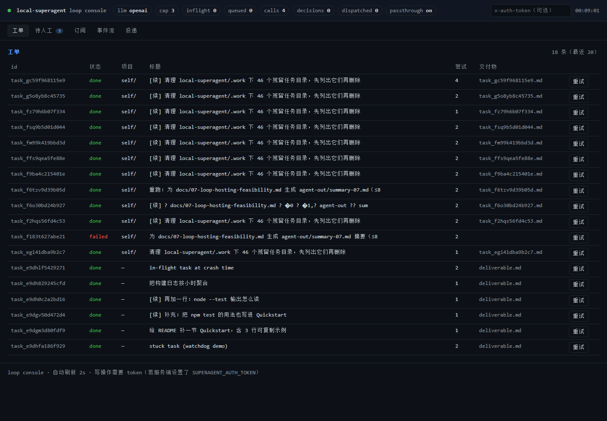

# 10 Loop Console（前后端入口）

> `http://127.0.0.1:3082/` 现在是一个真正的控制台（静态 SPA + 既有 JSON API），不再是服务端拼字符串的极简页面。
> 旧的单页视图保留在 `/legacy`，方便对照。



## 1. 它能看到什么

| 区域 | 内容 | 数据来源 |
| --- | --- | --- |
| 顶栏 | LLM 模式（openai/mock）、并发上限与在跑/排队、累计调用数、决策数、直通开关 | `/api/state` |
| 工单 | 最近 20 条：状态着色、项目、标题、尝试次数、交付物文件名、重试按钮 | `tasks[]` |
| 待人工 | 需要人决策的条目：原因、关联 trigger、批准/驳回 | `pending[]` + `POST /api/decisions/:id/resolve` |
| 订阅 | thread → worker session 的绑定、命中次数、解绑按钮 | `subscriptions[]` + `POST /api/unsubscribe` |
| 事件流 | 最近 15 条事件（kind/actor/task/时间） | `events[]` |
| 投递 | 表单直接 `POST /api/triggers`，返回原始 JSON | `/api/triggers` |

自动刷新 2 秒（只读 GET，不需要 token）。

## 2. 鉴权

服务端设了 `SUPERAGENT_AUTH_TOKEN` 时，所有 `POST /api/*` 需要 `x-auth-token` 头或 `Authorization: Bearer`。
控制台顶栏右侧有 token 输入框，存在 `localStorage`，只用于写操作；GET 不受影响。

## 3. 文件与路由

```
local-superagent/ui/index.html   页面骨架
local-superagent/ui/styles.css   深色主题（无构建步骤）
local-superagent/ui/app.js       轮询 /api/state + 三个写操作

GET  /              -> ui/index.html
GET  /app.js        -> ui/app.js
GET  /styles.css    -> ui/styles.css
GET  /ui/<file>     -> ui/<file>（只允许 html/js/css/svg，路径穿越拒绝）
GET  /legacy        -> 旧的服务端渲染页
```

静态服务只认白名单后缀且做目录边界校验（`test/governance.test.mjs` 里有一条用例断言 `/ui/../src/config.mjs` 不可读）。

## 4. 为什么不做前端框架

这是给运维看的状态台，不是产品界面：无构建、无依赖、单文件轮询，`node src/server.mjs` 起服务即可用。要换 React/Vite 也行，但会引入构建链，和“零依赖、随时能跑”的目标冲突。

## 5. 已知不足

1. 没有鉴权时的速率限制（现在靠 fast path 的令牌桶）。
2. 交付物只能显示文件名，点击不能直接打开（浏览器不允许读本地路径）——需要的话可以加一个 `/api/files/:taskId` 的只读预览接口。
3. 没有历史回溯：只看最近 20 条，长周期要看 SQLite。
